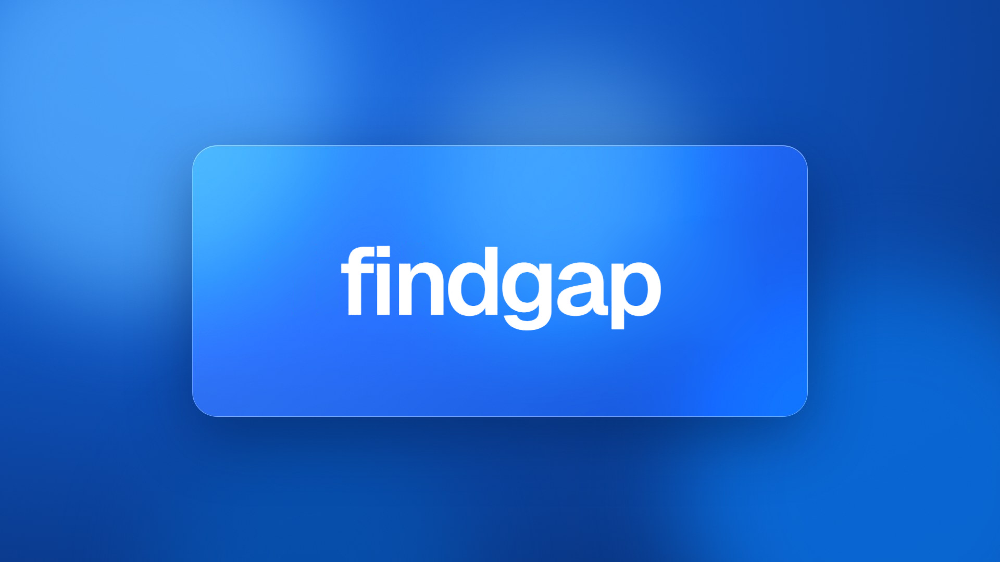

# findgap

<p align="center">
  
</p>

> **Find out what you only think you know.**
>
> 🇧🇷 [Leia em português](README.pt-BR.md)

findgap is an open-source [Agent Skill](https://agentskills.io) that turns Claude into a study partner who finds your real knowledge gaps — including the ones you don't know you have. It works for any field: pharmacology, React, structural engineering, constitutional law, Brazilian history, music theory.

It also helps with a newer worry: **are you letting AI do your thinking for you?** The *Thinking check* compares what you believe you can still do on your own with what you actually do without AI, task by task, and helps you keep the skills you need to own.

It doesn't just ask "what do you want to review?". It interviews you, maps what *ready* actually means for your goal, tests your understanding from recall up to transfer, asks how sure you are before every answer, and gives you an honest, kind report and a plan — all grounded in [learning-science research](skills/findgap/references/evidence-base.md).

## How it works

```
Intake → Knowledge map → Quiz (breadth) → Understanding Ladder (depth) → Gap report → Roadmap → Spaced re-tests
```

1. **Intake.** It starts with one open question: what brought you here today? A subject to master, the feeling you're not thinking as clearly, trouble with tasks, leaning on AI too much: anything counts, and you can bring more than one. Then a few targeted questions: what you're preparing for, by when, what defines "ready" (a syllabus, an exam blueprint, a job description) and what you studied from. Share your materials and it compares them against the requirement.
2. **Knowledge map.** A short tree of topics, each with a weight and a target depth. You confirm it before any testing.
3. **Quiz.** A confidence-rated quiz across the map, delivered as an interactive artifact. Every wrong option corresponds to a specific misconception or plausible error, so your mistakes say *why* you got it wrong.
4. **The Understanding Ladder.** For priority topics, findgap climbs rung by rung. The rung where you stall tells you what kind of gap it is:

| # | Rung | You're asked to… | Stalling here means… |
|---|---|---|---|
| 0 | Claim | Rate how well you know it | — (baseline) |
| 1 | Explain | Explain it from memory, or simply to someone who knows nothing (if you can't make it simple without making it wrong, you don't know it deeply yet) | You recognize it, but can't retrieve it |
| 2 | Probe | Answer why/how follow-ups | Words without a causal model |
| 3 | Analogy | Map it to everyday life, then say where the analogy breaks | Understanding tied to one framing |
| 4 | Apply | Solve a familiar problem | You know *about* it, but can't *do* it |
| 5 | Discriminate | Choose which concept applies, or spot the error in a solution | You don't know *when* to use it |
| 6 | Transfer | Handle a case unlike anything you studied | Knowledge that only works in the studied format |
| 7 | Retain | Pass again days later, without reviewing | Known today, gone later |

5. **Confidence × correctness.** A wrong answer you were *certain* about is the most dangerous gap of all, so findgap flags it, corrects it right away and always re-tests it later.
6. **Gap report and verdict.** Dangerous gaps first, then plain-language status per topic and how well you judged yourself. "Am I ready?" gets a criterion-based verdict (*Not yet / Close / Ready (provisional) / Ready (confirmed)*), never a feeling.
7. **Roadmap.** One concrete activity per gap, chosen for that type of gap, plus a re-test calendar scaled to your deadline.

### Thinking check: am I outsourcing my thinking?

For anyone who feels AI is doing too much of their thinking:

1. **Use map.** What you hand to AI, and for each task: do you need to own it, and how well could you do it alone today?
2. **Unplugged test.** One or two tasks you need to own, done (or explained) without AI.
3. **Judgment test.** An AI-style answer with one planted error: would you have used it?
4. **Reliance map.** Per task: *owned*, *fragile*, *crutch*, *illusion* (you thought you could, but couldn't), *blind trust*, or *healthy offloading*.
5. **Plan.** Try first, ask AI for hints instead of answers, explain back what it gave you, and re-test without AI on later days.

It is not a diagnosis and it never tells you AI is "rotting your brain". It shows evidence, task by task, and you decide.

**The voice:** a kind tutor who never lets an error slide. Every mistake is pointed out, clearly, without making you feel dumb. Want it harsher? Ask for *exam-board mode*.

## Install

findgap is updated often. Pick an install method that keeps up with it: every option below says how you get new versions.

### Claude Code and other agents (Cursor, Codex, OpenCode…)

```bash
npx skills add joaolobo10/findgap
```

To get updates later, run `npx skills update`.

#### Always the latest: clone and link

Clone the repo once and link the skill folder into your agent's skills directory. After that, one `git pull` brings in every change:

```bash
git clone https://github.com/joaolobo10/findgap.git ~/findgap
ln -s ~/findgap/skills/findgap ~/.claude/skills/findgap
```

On Windows (PowerShell):

```powershell
git clone https://github.com/joaolobo10/findgap.git "$HOME\findgap"
New-Item -ItemType Junction -Path "$HOME\.claude\skills\findgap" -Target "$HOME\findgap\skills\findgap"
```

To update, run `git pull` inside `~/findgap`, then start a new session (skills load when a session starts). This follows the `main` branch, so you get changes as soon as they land, before they're tagged as a release.

You can also just copy `skills/findgap/` into `~/.claude/skills/findgap/` (personal) or `.claude/skills/findgap/` (one project). A copy never updates itself: to get a new version, copy the folder again.

### Claude Code plugin marketplace

Inside Claude Code:

```
/plugin marketplace add joaolobo10/findgap
/plugin install findgap@findgap
```

On Claude Code 2.1.275 or later, one step is enough: `/plugin install findgap --marketplace joaolobo10/findgap`.

From a shell:

```bash
claude plugin marketplace add joaolobo10/findgap
claude plugin install findgap@findgap
```

Installed as a plugin, the skill is namespaced as `findgap:findgap`. You don't need to call it by name: just ask, as in the examples below.

To get updates, run `claude plugin marketplace update findgap`, or turn on auto-update for this marketplace in `/plugin` → **Marketplaces** (third-party marketplaces don't auto-update by default).

### Claude desktop and claude.ai

1. Download `findgap.zip` from the [latest release](https://github.com/joaolobo10/findgap/releases/latest).
2. In Claude, go to **Customize → Skills**, click **+**, then **Create skill → Upload a skill**, and choose the ZIP.
3. Make sure the skill is toggled on.

**The ZIP does not update itself.** An uploaded skill stays at the version you uploaded. To get new versions, follow this repo: on GitHub, click **Watch → Custom → Releases** to get notified when a release comes out. Then download the new `findgap.zip`, remove the old findgap skill in **Customize → Skills**, and upload the new one.

Skills require a plan and settings that support them. See [Using Skills in Claude](https://support.claude.com/en/articles/12512180-using-skills-in-claude).

## Usage

Just talk to Claude, in any language:

- *"I think I know pharmacology for the board exam in three weeks. Do I really?"*
- *"Me testa agora em hooks do React."*
- *"Explícame la carga de viento como si tuviera cinco años, y dime si de verdad lo entiendo."*
- *"Am I ready for a junior backend interview? Here's the job description."*
- *"Grill me on constitutional law — exam-board mode."*
- *"I feel like I can't do anything without ChatGPT anymore. Can you check?"*

| Mode | When |
|---|---|
| **Full diagnosis** | Default: intake, map, quiz, ladder, report, roadmap |
| **Quick check** | "Test me on X now": at most two questions, then straight to testing |
| **Explain** | One concept, rungs 0–3 |
| **Thinking check** | You worry about relying on AI: use map, tests without AI, reliance map, plan |
| **Review session** | You come back: due re-tests first, no reviewing beforehand |
| **Exam-board mode** | Same diagnosis, strict-examiner tone |

### Keeping your progress (optional, recommended)

findgap can remember your gaps and know what to re-test next time:

- **Claude app:** create a Project for your goal. At the end of each session, findgap gives you an updated `gap-log.md`; save it to the Project.
- **Claude Code:** findgap can keep a `.findgap/` folder in your working directory (it asks first).

## Evidence base

Every technique findgap uses is backed by research and documented — with effect sizes, caveats and DOIs — in [`evidence-base.md`](skills/findgap/references/evidence-base.md). Highlights:

- **Retrieval practice:** answering from memory beats re-reading (Roediger & Karpicke, 2006; Adesope et al., 2017).
- **Spacing:** re-tests spread over days beat cramming (Cepeda et al., 2006; Latimier et al., 2021).
- **Self-explanation and why-questions** (Bisra et al., 2018; Dunlosky et al., 2013).
- **The illusion of explanatory depth:** we think we understand until we try to explain (Rozenblit & Keil, 2002).
- **Hypercorrection:** confident errors are the most correctable, and the most likely to return (Butterfield & Metcalfe, 2001; Butler et al., 2011).
- **Mastery learning:** readiness is a criterion, not a feeling (Bloom, 1984; Kulik et al., 1990).
- **AI as a crutch:** students with unguarded AI access did better during practice but worse once it was removed (Bastani et al., 2025); offloading helps now but can cost memory (Grinschgl et al., 2021).

What findgap deliberately does **not** do: adapt to "learning styles" (Pashler et al., 2008), prescribe re-reading or highlighting, or use "do you feel ready?" as a measure.

## Limits

- findgap **diagnoses; it does not certify.** Its verdict is not an exam result, a job offer or a professional licence.
- Questions are written by an AI and can contain errors. In health, pharmacy, law and other high-stakes fields, check key facts against your official criterion or source. findgap says so whenever it is unsure.
- It is a study tool, not medical, legal or professional advice.

## Repository layout

```
skills/findgap/
├── SKILL.md                  # flow, ladder, voice: the core
├── references/               # loaded only when needed
│   ├── evidence-base.md      # the research, with DOIs
│   ├── intake.md · knowledge-map.md · understanding-ladder.md
│   ├── question-design.md · calibration.md
│   ├── gap-report.md · readiness-rubric.md · roadmap.md
│   └── thinking-check.md     # the AI-reliance check
└── assets/
    ├── quiz-template.html    # self-contained quiz artifact
    └── learner-profile.md · gap-log.md
```

The skill files are written in English, but Claude always replies in your language.

## Contributing

Issues and pull requests are welcome. A few rules keep findgap honest (see [`CLAUDE.md`](CLAUDE.md)):

- **Evidence first.** A new technique needs an entry in `evidence-base.md`, with a source that actually supports it, before it is used anywhere.
- **Nothing from the "Do not use" list.**
- **Domain-agnostic.** No content hardcoded for one field; examples span several fields.
- **Plain words for learners.** No pedagogy jargon in anything the learner sees.

## License

[MIT](LICENSE) © 2026 João Carlos Lobo S. Monteiro
